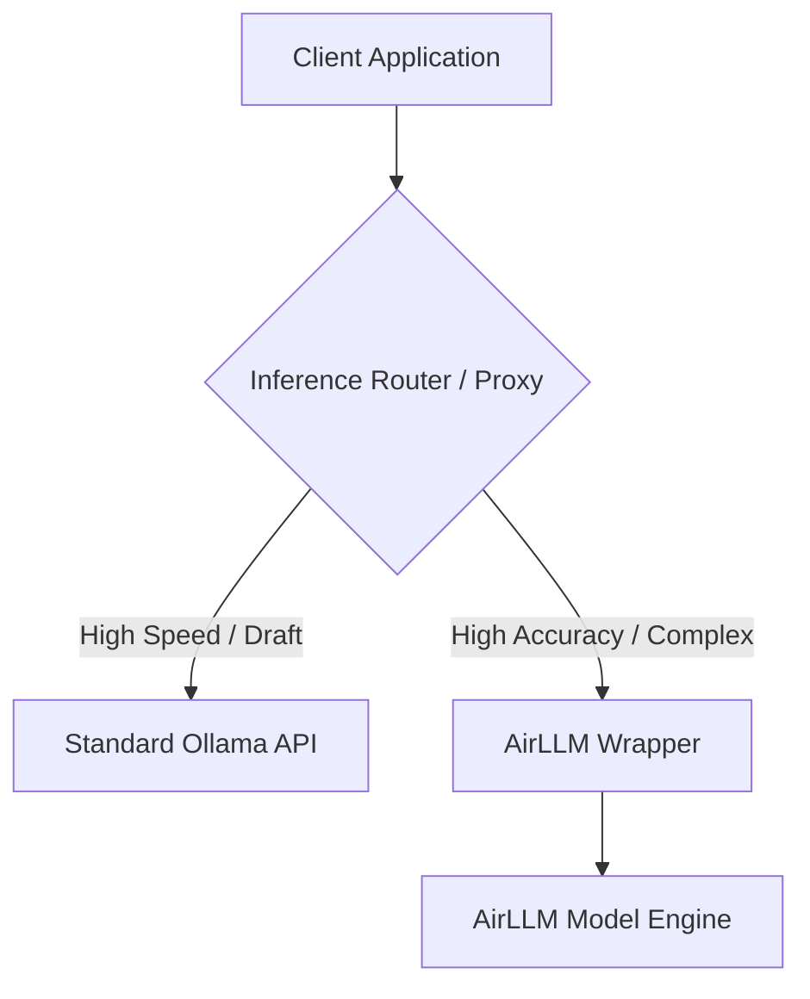

# AirLLM Ollama API Wrapper (`airllm-ollama-proxy`)

## Executive Summary

The **AirLLM Ollama API Wrapper** is a lightweight, high-precision proxy service that exposes a standard [Ollama REST API](https://github.com/ollama/ollama) interface powered by **[AirLLM](https://github.com/lyzhang1999/AirLLM)** execution under the hood. 

In microservice architectures or multi-agent AI pipelines, downstream applications often need to dynamically choose between **speed** (low latency, lower accuracy) and **capability/accuracy** (high parameter count, exact reasoning) on a per-request basis. By providing a transparent API surface compatible with standard Ollama client SDKs, this wrapper allows client applications to switch backends effortlessly—simply by toggling the target URL between a standard Ollama instance and this AirLLM wrapper—without changing any business logic or serialization code.

---

## Key Features

* **Transparent Ollama API Compatibility:** Implements core Ollama endpoints (`/api/generate`, `/api/chat`, `/api/tags`) to ensure full drop-in compatibility with existing Ollama software, client libraries, and SDKs.
* **Layered AirLLM Execution:** Leverages AirLLM’s layer-wise inference memory management to run large-parameter models locally on constrained hardware.
* **Single-Model Specialization:** Optimized for single-model deployment, reducing memory overhead and startup complexity.
* **Network & Timeout Optimized:** Built for same-network internal microservice communication where clients manage execution timeouts appropriate for AirLLM inference speeds.
* **Production-Grade Codebase:** Enforces high code quality standards out of the box, including full static type checking (`mypy`), strict linting (`ruff`), and $\ge 80\%$ unit/integration test coverage.

---

## Architectural Context



When speed is prioritized, requests are routed to standard Ollama nodes. When deep accuracy or large-context reasoning is required, requests are routed seamlessly to this AirLLM wrapper.

---

## Getting Started

### Prerequisites

* [uv](https://docs.astral.sh/uv/) (dependency manager; installs the Python interpreter for you)
* Python 3.11+ (managed automatically via `uv python install`)

### Installation

```bash
# Install the pinned dependencies from uv.lock
uv sync --dev

# Install the AirLLM runtime (pulls in torch/transformers, ~130 MB for torch
# alone on macOS arm64; the model weights are a separate download).
# On macOS the extra also installs Apple's MLX framework, which AirLLM
# imports but does not depend on.
uv sync --dev --extra airllm
```

### Choosing a model (smallest download first)

The server serves **one** model. The default is deliberately the smallest
checkpoint that exercises the full request path:

| Model | Weights | Notes |
| --- | --- | --- |
| `hf-internal-testing/tiny-random-LlamaForCausalLM` | **4.1 MB** | Random weights — smoke tests only. **Default.** |
| `HuggingFaceTB/SmolLM2-135M-Instruct` | 269 MB | Smallest *trained* Llama-architecture instruct model. |
| `Qwen/Qwen2.5-0.5B-Instruct` | 988 MB | Better quality, still small. |

**Where to change it**

* Per install / per run — environment variable or `.env`:
  `AIRLLM_OLLAMA_MODEL_NAME=HuggingFaceTB/SmolLM2-135M-Instruct`
* Code default — `DEFAULT_MODEL_NAME` in `src/airllm_ollama/config.py`
* Local checkpoint (no download at all) — `AIRLLM_OLLAMA_MODEL_PATH=/path/to/checkpoint`

### Downloading only what you need

AirLLM's own bootstrap downloads *every* file of the repository except the
weights — for `SmolLM2-135M-Instruct` that is **1.9 GB of ONNX exports** on top
of the 269 MB of weights. Pre-fetch a filtered snapshot instead and point the
server at the local directory; AirLLM then splits the local checkpoint and
downloads nothing:

```bash
# Optional: put the Hugging Face cache on an external drive
export HF_HOME="$HOME/hf-cache"

# Fetch only the config, tokenizer and weights (~6.5 MB for the tiny model)
uv run --extra airllm python - <<'PY'
from huggingface_hub import snapshot_download

print(snapshot_download(
    "hf-internal-testing/tiny-random-LlamaForCausalLM",
    allow_patterns=[
        "*.json", "*.safetensors", "tokenizer.model", "merges.txt", "vocab.json",
    ],
    local_dir="models/tiny-random-llama",
))
PY

# Serve the local checkpoint (no further downloads)
export AIRLLM_OLLAMA_MODEL_PATH="$PWD/models/tiny-random-llama"
```

Swap the repo id for `HuggingFaceTB/SmolLM2-135M-Instruct` (≈ 272 MB with this
filter) when you want real completions. AirLLM additionally writes one shard
per layer next to the checkpoint; set
`AIRLLM_OLLAMA_LAYER_SHARDS_SAVING_PATH` to relocate them.

### Running the application locally

```bash
# Start the API server on http://127.0.0.1:8000
# The extra is needed for inference; without it the API still answers, but
# every generation fails with a 503.
uv run --extra airllm uvicorn airllm_ollama.main:app --reload

# ...or via the module entry point (uses AIRLLM_OLLAMA_HOST/PORT)
uv run --extra airllm python -m airllm_ollama

# Verify the service is alive
curl http://127.0.0.1:8000/health
```

The server listens on port **8000** (uvicorn's default). Ollama's own port
11434 is available with `AIRLLM_OLLAMA_PORT=11434` — but a local Ollama
already occupies it.

Configuration is read from environment variables prefixed with `AIRLLM_OLLAMA_`
(see `.env.example`):

| Variable | Default | Description |
| --- | --- | --- |
| `AIRLLM_OLLAMA_HOST` | `127.0.0.1` | Server bind address |
| `AIRLLM_OLLAMA_PORT` | `8000` | Server port |
| `AIRLLM_OLLAMA_LOG_LEVEL` | `INFO` | Uvicorn log level |
| `AIRLLM_OLLAMA_MODEL_NAME` | `hf-internal-testing/tiny-random-LlamaForCausalLM` | Name of the single served model |
| `AIRLLM_OLLAMA_MODEL_PATH` | _(empty)_ | Local checkpoint path; empty means "fetch `<model name>` from Hugging Face" |
| `AIRLLM_OLLAMA_DEVICE` | `cuda:0` | Device passed to AirLLM (ignored by the MLX backend) |
| `AIRLLM_OLLAMA_MAX_SEQ_LEN` | `512` | Maximum context length |
| `AIRLLM_OLLAMA_LAYER_SHARDS_SAVING_PATH` | _(empty)_ | Where AirLLM stores the per-layer shards |
| `AIRLLM_OLLAMA_KEEP_ALIVE` | _(empty)_ | Default lifetime of the loaded model (e.g. `5m`); empty keeps it loaded |
| `AIRLLM_OLLAMA_STREAM_FORMAT` | `ndjson` | Framing of the streaming responses: `ndjson` (like Ollama) or `sse` |

### API

The `/api/*` routes mirror Ollama's REST interface, so standard Ollama clients
work against this service unchanged.

| Method | Path | Description |
| --- | --- | --- |
| `GET` | `/` | Plain-text announcement: `airllm-ollama is running` (or `kinda running` without the AirLLM runtime) |
| `GET` | `/health` | Liveness probe; `model_loaded` tells whether the weights are in memory |
| `GET` | `/api/version` | Server version, as in Ollama |
| `GET` | `/api/tags` | The single served model with its metadata, as in Ollama |
| `POST` | `/api/generate` | Completion, as in Ollama (streaming and non-streaming) |
| `POST` | `/api/chat` | Chat completion, as in Ollama (streaming and non-streaming) |
| `GET` | `/docs` | Interactive OpenAPI documentation |

```bash
curl http://127.0.0.1:8000/api/tags
```

```json
{
  "models": [
    {
      "name": "hf-internal-testing/tiny-random-LlamaForCausalLM",
      "model": "hf-internal-testing/tiny-random-LlamaForCausalLM",
      "modified_at": "2026-10-23T11:29:33.028910Z",
      "size": 4194304,
      "digest": "sha256:35bac10d539b472e8d971660006ffc27ba2736cdf74da9c0a3722603596df9ec",
      "details": {
        "parent_model": "",
        "format": "safetensors",
        "family": "llama",
        "families": ["llama"],
        "parameter_size": "135M",
        "quantization_level": "",
        "context_length": 512
      },
      "capabilities": ["completion"]
    }
  ]
}
```

`/api/tags` derives its metadata from the **local** checkpoint only — size,
`sha256` digest, architecture family and parameter count (read from the
safetensors header). Nothing is ever downloaded to answer it; a model that has
not been fetched yet is listed with empty metadata.

### Generating

```bash
curl http://127.0.0.1:8000/api/generate \
  -H 'Content-Type: application/json' \
  -d '{
        "model": "hf-internal-testing/tiny-random-LlamaForCausalLM",
        "prompt": "Why is the sky blue?",
        "options": {"temperature": 0.7, "num_predict": 128}
      }'
```

```json
{
  "model": "hf-internal-testing/tiny-random-LlamaForCausalLM",
  "created_at": "2026-10-23T11:45:10.123456Z",
  "response": "The sky is blue because...",
  "done": true,
  "done_reason": "stop",
  "total_duration": 812345678,
  "load_duration": 402345678,
  "prompt_eval_count": 6,
  "prompt_eval_duration": 1200000,
  "eval_count": 24,
  "eval_duration": 408945678
}
```

With `stream: true` the answer is streamed: one JSON object per line, each
one a partial answer, the last one carrying the timings and `done: true` — the
format Ollama uses (`application/x-ndjson`). The official Ollama clients parse
the response line by line, so this is the default; Server-Sent Events can be
selected with `AIRLLM_OLLAMA_STREAM_FORMAT=sse`.

```bash
curl -N http://127.0.0.1:8000/api/generate \
  -H 'Content-Type: application/json' \
  -d '{"model": "...", "prompt": "Why is the sky blue?", "stream": true}'
```

```
{"model":"...","created_at":"...","response":"The ","done":false}
{"model":"...","created_at":"...","response":"sky is ","done":false}
{"model":"...","created_at":"...","response":"blue.","done":false}
{"model":"...","created_at":"...","response":"","done":true,"done_reason":"stop", ...}
```

| Ollama request field | Behaviour |
| --- | --- |
| `model` | Required; an unknown model is answered with `404` and `{"error": "..."}` |
| `prompt` | The text to complete |
| `system` | Rendered with the chat template of the model, like `/api/chat` does; models without a template get the plain transcript. Without a `system` message the prompt is sent unchanged (Ollama would still apply the template) |
| `options.temperature` / `top_p` / `top_k` | Applied (and sampling is enabled) |
| `options.num_predict` | Mapped to the number of generated tokens |
| `options.num_ctx` | Mapped to the maximum sequence length |
| `options.repeat_penalty` | Mapped to the repetition penalty |
| `options.stop` | The response is cut at the first stop sequence |
| `options.seed`, `mirostat*`, `presence_penalty`, `frequency_penalty` | Accepted, but not applied (no llama.cpp sampler) |
| `keep_alive` | Unloads the model after the given idle time (`"30s"`, `"5m"`, `"1h"`, `"0"`). Without it the model stays in memory, because reloading an AirLLM checkpoint is expensive. A service-wide default can be set with `AIRLLM_OLLAMA_KEEP_ALIVE` |
| `raw`, `format`, `template`, `context`, `suffix` | Accepted, but not applied |

Errors follow Ollama's format: `404` for an unknown model, `503` when the
model cannot be loaded and `400` for an invalid request body.

### Chatting

```bash
curl http://127.0.0.1:8000/api/chat \
  -H 'Content-Type: application/json' \
  -d '{
        "model": "hf-internal-testing/tiny-random-LlamaForCausalLM",
        "messages": [
          {"role": "system", "content": "You are terse."},
          {"role": "user", "content": "Why is the sky blue?"}
        ]
      }'
```

```json
{
  "model": "hf-internal-testing/tiny-random-LlamaForCausalLM",
  "created_at": "2026-10-23T12:00:19.123456Z",
  "message": {"role": "assistant", "content": "Rayleigh scattering."},
  "done": true,
  "done_reason": "stop",
  "total_duration": 812345678,
  "load_duration": 402345678,
  "prompt_eval_count": 12,
  "prompt_eval_duration": 1200000,
  "eval_count": 6,
  "eval_duration": 408945678
}
```

The history is rendered with the **chat template of the model**
(`tokenizer.apply_chat_template`). Base models have no template — for them the
history is flattened into a plain transcript:

```
System: You are terse.

User: Why is the sky blue?

Assistant:
```

`options`, `keep_alive` and `stream` behave exactly like in `/api/generate`.

### Verifying a running instance

```bash
# Check the endpoints of a running service
uv run python -m airllm_ollama --check
uv run python -m airllm_ollama --check --url http://127.0.0.1:8000 --timeout 2
```

```
OK   /              airllm-ollama is running
OK   /health        ok
OK   /api/version   version 0.1.0
OK   /api/tags      1 model(s)
4/4 checks passed
```

The check verifies the status *and* the payload of every endpoint, and exits
with `1` when something is wrong — handy as a container health probe.

### Running the tests

```bash
# Full suite with coverage (enforces >= 80% coverage)
uv run pytest

# Single file / single test
uv run pytest tests/test_api_health.py
uv run pytest tests/test_api_health.py::test_health_returns_ok

# HTML coverage report
uv run coverage html && open htmlcov/index.html
```

### Quality gates

The same commands run in CI on every push and pull request:

```bash
uv lock --check              # lock file is up to date
uv run ruff format --check . # formatting
uv run ruff check .          # linting
uv run mypy .                # static type checking (strict)
uv run pytest                # tests + coverage gate
```

### Project layout

```
src/airllm_ollama/
├── __init__.py        # package exports
├── __main__.py        # `python -m airllm_ollama` entry point
├── api/routes.py      # HTTP routes (/, /health, /api/*)
├── chat.py            # rendering of chat histories into a prompt
├── config.py          # environment-driven settings
├── engine.py          # AirLLM singleton wrapper (lazy load, thread-safe)
├── exceptions.py      # error hierarchy
├── main.py            # FastAPI application factory
├── model_metadata.py  # checkpoint metadata (size, digest, family, params)
├── options.py         # translation of Ollama's options
├── schemas/           # pydantic request/response models
├── streaming.py       # streamer turning the generated tokens into text
└── version.py         # package version
tests/                 # pytest suite (unit, integration and end-to-end)
.github/workflows/ci.yml
```

